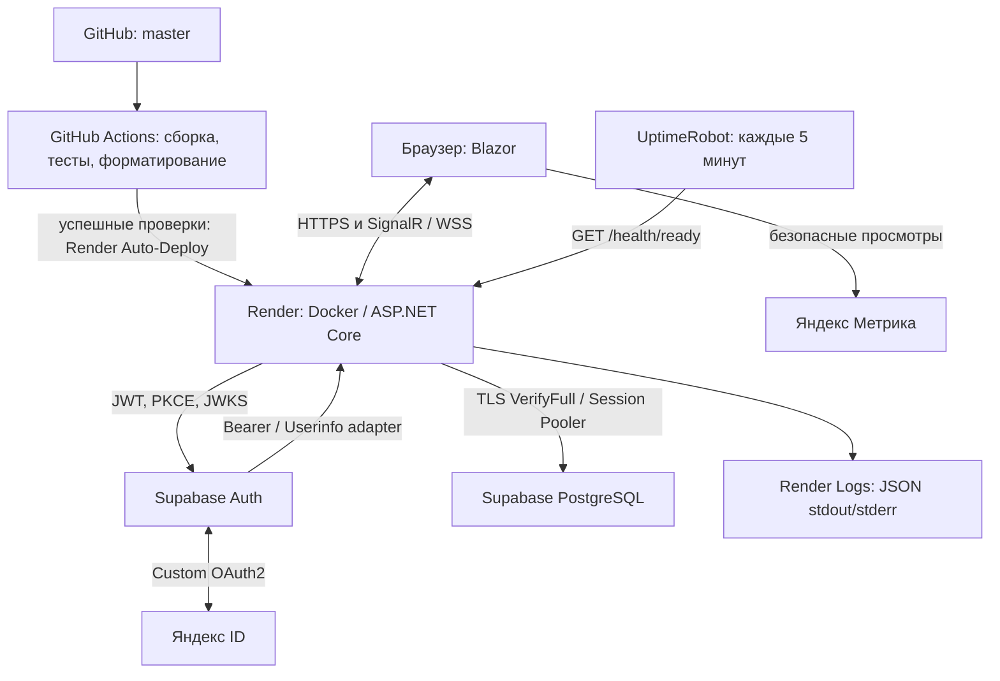

# Лабораторная №6: интеграции EquipmentManager

Приложение: [equipment-manager-demo.onrender.com](https://equipment-manager-demo.onrender.com/).
Исходный код: [Azeend/EquipmentManager](https://github.com/Azeend/EquipmentManager), ветка `master`.

Документ описывает итоговое состояние кода. По подтверждению владельца, CI/CD, вход через
Яндекс, Метрика, Health Checks, UptimeRobot и JSON-логи проверены на опубликованном приложении.
При подготовке этого документа облачные настройки и реальные данные не изменялись;
локальные тесты не заменяют проверку внешних сервисов. Ранние отчёты сохраняют результаты
своих этапов (например, 140 или 186 тестов), а не текущий размер набора.

## Архитектура и технологии

ASP.NET Core .NET 9, C#, Blazor InteractiveServer, Razor и Bootstrap образуют серверное
веб-приложение и Backend REST API. Npgsql обеспечивает доступ к Supabase PostgreSQL.
Supabase Auth выпускает JWT; интерфейс использует защищённую cookie и серверный
`UiSessionStore`. xUnit проверяет .NET-код; встроенный Node.js test runner — модуль аналитики.
Сторонние OAuth-библиотеки и пакеты логирования не используются.



Blazor выполняет интерактивную логику на сервере. Браузеру требуется постоянная связь
SignalR; это Web Service, а не статический хостинг. UI вызывает Backend API с серверным
Bearer-токеном. Права определяются активным PostgreSQL-профилем по UUID из проверенного JWT.
Инженер управляет оборудованием и регистрирует заявки, специалист обрабатывает заявки,
руководитель читает данные. Email, Яндекс ID и метаданные провайдера не назначают роли.

## CI/CD: GitHub Actions → Render

**Назначение:** проверка изменений до автоматической публикации.
Workflow `.github/workflows/ci.yml` запускается при push в `master` и pull request в `master`:
`ubuntu-latest`, SDK `9.0.x`, checkout → restore → Release build → xUnit → format.
Разрешение GitHub ограничено `contents: read`, общий тайм-аут — 15 минут.
Фильтр `Category!=PostgresIntegration` и пустой `EM_PG_TEST_RUN` исключают облачный тест.
CI не требует секретов Supabase; JS-тесты пока запускаются отдельно, workflow их не содержит.

На стороне Render настроены репозиторий, `master`, Docker, Frankfurt, Free и
Auto-Deploy **After CI Checks Pass**. Workflow сам не вызывает Deploy Hook и не хранит
ключ Render. Успешный CI разрешает сборку/деплой платформой, но не гарантирует успешный
запуск контейнера: результат проверяется отдельно в Events и Logs.

Dockerfile публикует веб-проект в SDK-стадии, использует Debian runtime .NET 9,
непривилегированного пользователя `$APP_UID`, порт 10000 и явный список COPY.
`.dockerignore` исключает локальные секреты и лишние артефакты.

**Проверка:** Actions → CI — все этапы успешны; Render → Events — нужный commit и Live;
далее GET `/health/live`, `/health/ready` и обычный вход. Не публиковать секреты в build args.
Подробности: [render_deployment.md](render_deployment.md).

## Основные настройки Render и PostgreSQL

В Environment используются ключи ниже. Секретные значения вводятся только владельцем;
реальные строки подключения здесь намеренно отсутствуют. Имена .NET-конфигурации в
переменных окружения используют двойное подчёркивание.

| Ключ | Значение или источник |
|---|---|
| `ASPNETCORE_ENVIRONMENT` | `Production` |
| `ASPNETCORE_URLS`, `PORT` | `http://0.0.0.0:10000`, `10000` |
| `AllowedHosts` | `equipment-manager-demo.onrender.com` |
| `Hosting__RenderFreeProxy`, `Hosting__RenderProxy` | `true`, `false` для выбранного учебного режима |
| `RENDER` | Предоставляется платформой; не является самостоятельным основанием доверия |
| `Storage__Provider` | `PostgreSQL` |
| `SupabaseUiAuth__BackendBaseUrl` | `https://equipment-manager-demo.onrender.com/` |
| `SupabaseAuth__Enabled`, `SupabaseAuth__SettingsConfirmed` | `true`, `true` после проверки проекта |
| `SupabaseAuth__Issuer` | HTTPS URL своего Supabase-проекта с `/auth/v1` |
| `SupabaseAuth__Audience`, `SupabaseAuth__SigningAlgorithm` | `authenticated`, `ES256` для текущей конфигурации; должны соответствовать проекту |
| `SupabaseUiAuth__PublishableKey` | Publishable key того же проекта из Supabase |
| `ConnectionStrings__Profiles` | Session Pooler, ограниченная роль чтения профилей `equipment_app` |
| `ConnectionStrings__EquipmentCrud` | Session Pooler, ограниченная роль данных `equipment_api` |

Параметры хоста, порта, базы и имени pooler-пользователя берутся из настроек подключения
существующего проекта, пароли — у владельца соответствующих ролей. Требуются
`SSL Mode=VerifyFull` и
`Root Certificate=/usr/local/share/ca-certificates/supabase-ca.crt` в обеих строках.
Docker проверяет публичный CA по закреплённому SHA-256, сроку, CA:TRUE и подписи, затем
добавляет его в системное хранилище Debian. Windows-путь не используется.
Проверка имени сервера сохраняется. Ротация CA требует проверки официального сертификата
и обновления закреплённого отпечатка; пароль и закрытый ключ в образ не помещаются.

**Назначение БД:** постоянное хранение оборудования, заявок, истории и профилей.
SQL параметризован, приложения используют ограниченные роли, а не административный доступ.
При отказе PostgreSQL нет автоматической подмены рабочей базы памятью.
**Проверка:** readiness подтверждает подключение, функциональные сценарии — чтение и
разрешённые операции под существующими ролями. Не изменять production-данные ради диагностики.
Полный шаблон: [.env.example](.env.example); он автоматически не загружается.

## Авторизация: Supabase Auth и Яндекс OAuth2

**Назначение:** дополнительный способ входа без независимой системы пользователей.
Email/password сохранён. Оба входа проходят цепочку: Supabase JWT → подпись/JWKS,
issuer, audience, exp → UUID `sub` → активный профиль с разрешённой ролью → серверный
сеанс → Secure/HttpOnly cookie. JWT не хранится в localStorage и не помещается в cookie.
Сеанс ограничен сроком JWT и максимумом восемь часов; перезапуск требует повторного входа.

Для Яндекса нужны `YandexOAuth__Enabled=true` и `YandexOAuth__ClientId` в Render.
Client Secret приложения Яндекса хранится только в Custom Provider Supabase.
Провайдер `custom:yandex` использует authorize `https://oauth.yandex.ru/authorize`,
token `https://oauth.yandex.ru/token`, scope `login:info`, PKCE и `email_optional=true`.
Userinfo URL: `https://equipment-manager-demo.onrender.com/oauth/yandex/userinfo`.
Адаптер проверяет Bearer-токен через фиксированный API Яндекса, валидирует `client_id`
и стабильный `id`, возвращает только `sub`, без email.

Яндекс возвращает пользователя в **Callback URL из формы Supabase** (`/auth/v1/callback`
на домене своего проекта). Supabase возвращает пользователя в приложение:

- `https://equipment-manager-demo.onrender.com/account/oauth/callback`;
- `https://localhost:7128/account/oauth/callback` для локальной разработки.

Эти адреса добавляются в Supabase Redirect URLs; Site URL указывает на Render.
POST начала OAuth защищён antiforgery. PKCE verifier хранится на сервере; собственный
одноразовый state живёт пять минут и связан с браузером через защищённую correlation cookie.
Код обменивается сервером, callback не принимает произвольный внешний returnUrl.
Для существующего пользователя: вход по паролю → `/account/session` → «Привязать Яндекс»
(manual identity linking должен быть разрешён в Supabase) → выход → вход через Яндекс.
Привязка требует тот же сеанс и UUID. Новому OAuth-пользователю без профиля доступ не выдаётся.

**Проверка:** оба способа входа, выход, отказ пользователя и повторный вход; отсутствие
профиля должно давать отказ. Повтор state/неверный JWT проверяются изолированными тестами.
Доступность облачного Custom OAuth2 и его поля зависят от версии Supabase Dashboard:
код не использует Yandex OIDC/JWKS и не определяет смысл обязательного Issuer в форме.
Не подставлять фиктивный issuer и не ослаблять JWT-проверки при повторной настройке;
действующую облачную конфигурацию документировать отдельно без секрета. Историческая
инструкция [oauth_yandex.md](oauth_yandex.md) описывает ручной OAuth2, но не подтверждает
совместимость любой будущей формы Dashboard.

## Яндекс Метрика

**Назначение:** статистика просмотров разрешённых страниц. Настройки:
`Analytics__YandexMetrika__Enabled=true`, `Analytics__YandexMetrika__CounterId=113657931`,
`Analytics__YandexMetrika__PublicOrigin=https://equipment-manager-demo.onrender.com`.
В коде аналитика по умолчанию выключена; вне Production/правильного origin не работает.

Официальный `https://mc.yandex.ru/metrika/tag.js` загружается после интерактивного рендера.
`defer:true` отключает автоматический просмотр, модуль посылает ручной hit при смене
разрешённого маршрута и устраняет дубли рендера. Разрешены `/`, `/equipment`, `/faults`,
`/maintenance-history`, `/counter`, `/weather`; страницы с query/hash полностью исключены.
Вход, выход, сеанс, OAuth callback, API и неизвестные пути не учитываются.
Названия и referer фиксированы/очищены; формы, email, UUID и токены не передаются кодом.
Вебвизор, ecommerce и запись форм не включаются. В интерфейсе счётчика владелец также
должен отключить автосбор, дополнительные теги и автоматические цели.

**Проверка:** Network браузера и отчёт счётчика: переходы оборудования → заявки → Back
дают по одному просмотру; callback не создаёт просмотр; блокировка скрипта не ломает UI.
По сообщению владельца, просмотры поступают. Метрика как сторонний сервис получает IP и
технические сведения браузера, может использовать свои cookies; отдельного consent UI нет.
Подробности и JS-тесты: [metrika_integration.md](metrika_integration.md).

## Health Checks и UptimeRobot

**Назначение:** различать живой процесс и доступность обязательных подключений.
GET/HEAD `/health/live` проверяет процесс, `/health/ready` дополнительно выполняет только
`SELECT 1` через настройки Profiles и EquipmentCrud при включённых зависимостях.
Таблицы, роли и данные не меняются. Общий бюджет PostgreSQL-пробы — четыре секунды,
результат кешируется на пять секунд, параллельные запросы объединяются.
Healthy возвращает HTTP 200, Unhealthy/Degraded — 503. Публичный JSON содержит только
общий статус, без исключений и параметров соединения; HTTP-кеширование запрещено.

UptimeRobot настроен владельцем на HTTPS GET
`https://equipment-manager-demo.onrender.com/health/ready` каждые пять минут; текущий
подтверждённый статус — Up. Сервис внешнего опроса не является библиотекой приложения.
Получателей уведомлений и их работоспособность нужно проверять отдельно в UptimeRobot;
из кода наличие настроенного alert-канала установить нельзя.

**Ручная проверка без входа:**

```powershell
curl.exe -i https://equipment-manager-demo.onrender.com/health/live
curl.exe -i https://equipment-manager-demo.onrender.com/health/ready
```

Ожидается 200 и `{"status":"Healthy"}`. Live=200, ready=503 означает отказ зависимости;
причину искать в безопасных логах, не менять рабочие секреты для имитации отказа.
SELECT 1 не проверяет все таблицы, операции API, OAuth и доставку аналитики.
Подробнее: [health_monitoring.md](health_monitoring.md).

## Структурированные журналы

Встроенные Microsoft.Extensions.Logging и JSON Console Formatter выводят одну JSON-строку
на событие: Information/Warning в stdout, Error/Critical в stderr. Смотреть Render → Logs.
Поля: Timestamp (UTC), LogLevel, Category, EventId, Message, State.
Искать `ApplicationStarted` (1000), `ApplicationFailed` (1002), `SupabaseSignInRejected`
(2001), `AuthorizationDenied` (2002), `ProfileStoreUnavailable` (3001),
`PostgresConnectionFailed` (3003), `HealthStateChanged` (6001).
Новых переменных окружения для логирования не требуется.

Production допускает только проверенные категории, выключает scopes и сырые сообщения
фреймворка. События содержат этап, тип ошибки, фиксированную категорию или числовой статус,
а не пароли, URL/query, JWT, cookie, OAuth-код, тело ответа, email или пользовательский UUID.
Health Checks пишут первое наблюдение и смену состояния; успешный пятиминутный опрос
не создаёт повторяющийся access log. JSON formatter сам по себе не редактирует секреты:
новые сообщения требуют проверки. Подробные stack traces и часть фоновой circuit-диагностики
в Production недоступны. **Проверка:** событие запуска после деплоя и валидный JSON;
негативные сценарии воспроизводить локально. См. [structured_logging.md](structured_logging.md).

## Безопасность и секреты

[security_audit.md](security_audit.md) содержит результаты OWASP-анализа, NuGet-проверки,
исправлений и остаточных рисков на дату аудита. Это исторический результат, не гарантия
отсутствия новых уязвимостей. Повторная проверка: `dotnet list package --vulnerable --include-transitive`.

- JWT проверяется до доверия claims; права читаются из PostgreSQL. Cookie Secure,
  HttpOnly, SameSite=Lax; изменение сеанса требует CSRF-защиты. API использует Bearer.
- SQL параметризован; Razor экранирует данные. API возвращает безопасные ошибки без
  SQL/stack trace/секретов. HTTPS, HSTS и защитные заголовки сохранены.
- Секреты подключения и ключ Auth читаются из User Secrets только в Development либо
  из окружения. Production — Render Environment; Yandex Client Secret — Supabase Provider.
  Не использовать service_role. Не хранить секреты в Git, Docker ARG, README или логах.
- `.env` и `appsettings.Local.json` автоматически не загружаются; .gitignore не удаляет
  секрет, уже попавший в историю. При утечке требуется ротация, а не только удаление файла.
- Доступ к GitHub, Supabase, Render Logs и UptimeRobot ограничивать владельцами;
  MFA, уведомления, хранение логов и защиту master проверять отдельно.

## Ограничения Render Free и дальнейшие работы

По [официальным ограничениям Render Free](https://render.com/docs/free), сервис может
засыпать после 15 минут без входящего трафика; запуск по запросу занимает время.
Локальная файловая система непостоянна, постоянный диск Free недоступен. Квоты и
доступность зависят от тарифа; опрос UptimeRobot создаёт входящий трафик, но не гарантирует
непрерывную работу, не отменяет лимиты и не заменяет платное размещение для постоянной нагрузки.

Перезапуск теряет Blazor circuits, серверные сеансы и незавершённый OAuth state;
нужен повторный вход. Данные PostgreSQL остаются в Supabase, а InMemory теряет данные.
Холодный старт может сорвать OAuth/Userinfo по тайм-ауту; он не входит в бюджет SELECT 1.
Масштабирование на несколько процессов потребует общего хранилища сеансов/state и
Data Protection, а также отдельной настройки Blazor/SignalR.

Явный `Hosting__RenderFreeProxy=true` принимает только X-Forwarded-Proto с лимитом один
переход без проверки IP, полагаясь на ingress и изоляцию Render. Требуется также RENDER,
но один этот флаг режим не включает. Любой прямой доступ к Kestrel в таком режиме позволил
бы подделать схему. Это согласованный учебный компромисс, не строгая проверка источника.
Обычный режим выключен по умолчанию; строгий `Hosting__RenderProxy=true` требует
подтверждённых `Hosting__KnownProxies__N` и не может работать одновременно с Free-режимом.

Для постоянной эксплуатации отдельно запланировать поддерживаемую версию .NET,
обновления зависимостей/контейнера, строгую инфраструктуру прокси, защиту от перебора,
пагинацию, резервирование и политику аналитики. Эти изменения в документационную задачу
не входят; текущий аудит не доказывает защищённость от всех угроз.

## Локальный запуск и итоговая проверка

Требуются .NET SDK 9 и Node.js со встроенным `node:test` для JS-проверок (без npm install).
Открыть `EquipmentManager.sln`, доверить dev HTTPS-сертификат и использовать профиль https:
`https://localhost:7128/`. Через User Secrets или окружение задать подключения и publishable
key своего проекта, проверить SupabaseAuth и `BackendBaseUrl`. Для постоянного хранения
выбрать `Storage:Provider=PostgreSQL`; значение appsettings по умолчанию — InMemory.
Даже InMemory при включённом Auth требует доступного источника профилей. Для существующей
БД не повторять SQL-установку. Подробности: [README](README.md),
[backend_documentation.md](backend_documentation.md), [ui_auth_setup.md](ui_auth_setup.md).

```powershell
dotnet restore EquipmentManager.sln
dotnet build EquipmentManager.sln --configuration Release --no-restore
dotnet test EquipmentManager.sln --configuration Release --no-build --no-restore --filter "Category!=PostgresIntegration"
node --test EquipmentManager.Tests/metrika.test.mjs
dotnet format EquipmentManager.sln --verify-no-changes --no-restore
dotnet run --project EquipmentManager.csproj --launch-profile https
```

Текущий обычный набор: 280 .NET-тестов и 10 JS-тестов. Auth, JWKS и PostgreSQL-пробы
подменяются; облачный PostgresIntegration исключён. Команды не подтверждают актуальные
настройки Dashboard или успешный реальный OAuth: опубликованные сценарии подтверждены
отдельно владельцем. Настоящие секреты и основная база для обычных тестов не требуются.
